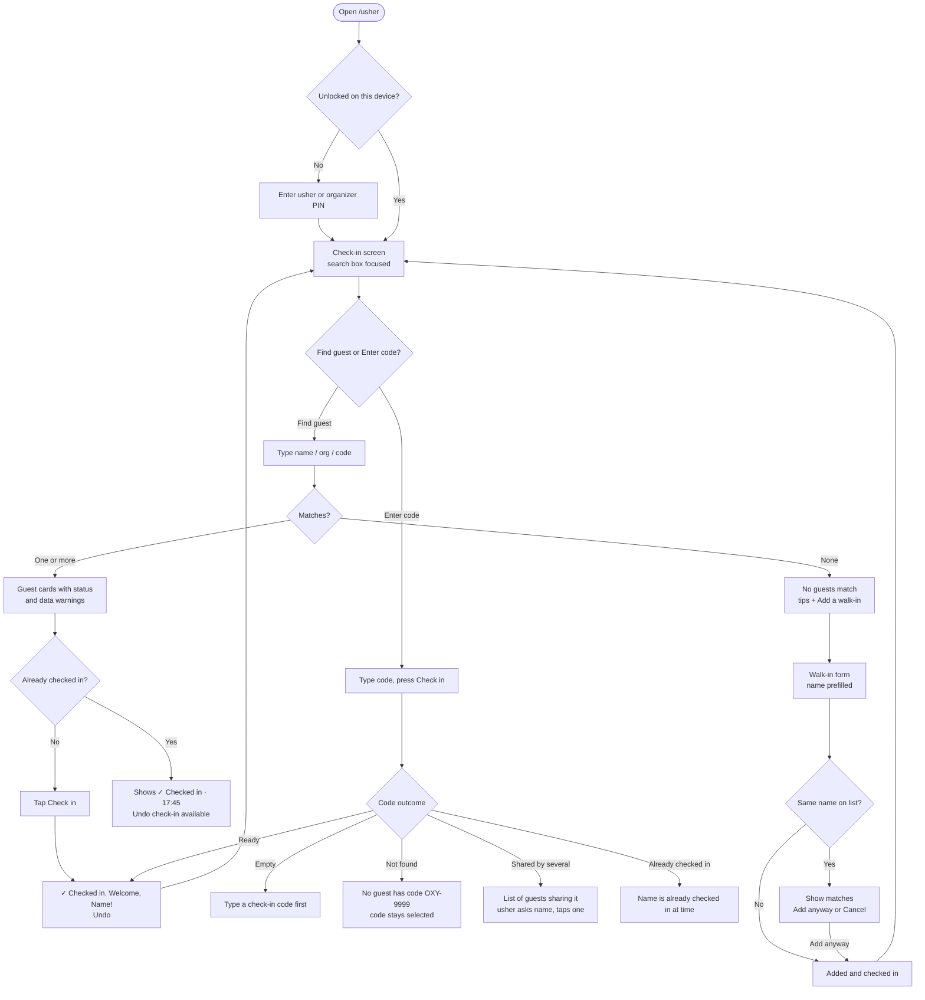
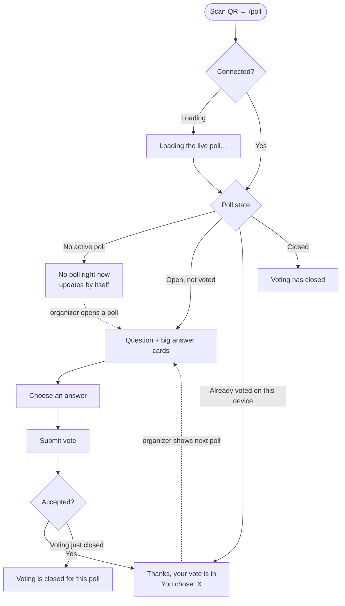
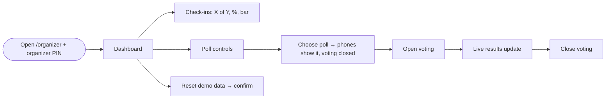

# UX Notes: LaunchPad

Flows, screen states, and the design decisions behind them. Brand values come from `docs/brand-guide.md` (a stand-in until the real guide arrives) and live in `src/styles/tokens.css`.

## Design principles

1. **Fewest steps to the answer.** Check-in is _type, then one tap_. Voting is _choose, then submit_.
2. **One-handed, thumb-first.** 48px touch targets; primary actions full-width at the bottom of cards; navigation at the bottom of the screen.
3. **Feedback for every action, never colour alone.** Every result has an icon, plain words and, where it makes sense, Undo.
4. **Never guess on the guest's behalf.** Ambiguous data (shared codes, same names) is shown to a human, not resolved silently.
5. **Calm under pressure.** Short, friendly copy ("Checked in. Welcome, Amina!"), no exclamation-mark overload, no timeouts that make messages vanish.

---

## Usher flow

## Attendee flow

## Organizer flow

---

## Screen states (every one is designed)

| Screen    | States                                                                                                                                                            |
| --------- | ----------------------------------------------------------------------------------------------------------------------------------------------------------------- |
| Usher     | PIN gate, empty search, results, more than 50 results ("keep typing"), no results, guest list failed to load, checked in, already checked in, saving, save failed |
| Code      | ready, empty, not found, shared code (choose), already checked in, success                                                                                        |
| Walk-in   | empty name error, same-name warning, saving, added                                                                                                                |
| Poll      | loading, no active poll, open, submitting, voted, closed, closed while choosing                                                                                   |
| Organizer | no poll selected, poll shown but closed, voting open, results with zero votes, reset confirmation, save failed                                                    |
| All       | connecting banner, offline banner, 404 page                                                                                                                       |

---

## Design decisions (and what I decided against)

| Decision                                                | Decided against                      | Why                                                                                 |
| ------------------------------------------------------- | ------------------------------------ | ----------------------------------------------------------------------------------- |
| Large search box pinned to the top, focused on open     | A filter panel or a table            | One field covers name, organization and code; tables are cramped at 360px           |
| Feedback shown under the input, no timeout              | Toasts at the bottom that disappear  | Bottom toasts hide behind the phone keyboard; disappearing Undo is a trap           |
| Undo instead of "Are you sure?"                         | Confirmation dialogs before check-in | Confirmations slow a busy door; Undo is faster and just as safe                     |
| Separate "Enter code" mode                              | Only search                          | Scanner-style "type, then go" is one action shorter and maps to a future QR scanner |
| Show shared codes / same names as warnings, ask a human | Auto-merging similar records         | Two Grace Wambuis at different companies are different people                       |
| Choose, then submit for votes                           | One-tap voting                       | Votes can't be changed, so a stray tap shouldn't count                              |
| No navigation on the attendee poll screen               | Always-visible navigation            | Attendees should see one thing; nav would invite them into staff screens            |
| Picking a poll keeps voting closed                      | Opening voting automatically         | Going live should be a deliberate act                                               |
| Single-hue result bars with numbers written beside them | Multi-colour pie or donut charts     | Bars compare more accurately; numbers make the chart readable without colour        |
| Status as text + icon + coloured edge                   | Colour-only status dots              | WCAG: colour must never be the only signal                                          |
| Bottom navigation for staff                             | Hamburger menu                       | Three destinations fit in a thumb-reachable bar; menus hide them                    |
| System fonts as a fallback while brand fonts load       | Blocking until fonts load            | Text must appear immediately on slow venue Wi-Fi                                    |

## Accessibility summary

- Semantic HTML: one `<h1>` per screen, landmarks, `<fieldset>`/`<legend>` for poll answers, real radio buttons and form labels.
- Visible focus ring on every interactive element; a skip link to the main content.
- Live regions announce search result counts, action results (errors assertively) and vote confirmations.
- All colour pairs measured against WCAG AA; automated axe audit on 13 screens and states (see DECISIONS D25).
- Reduced-motion preference respected.
