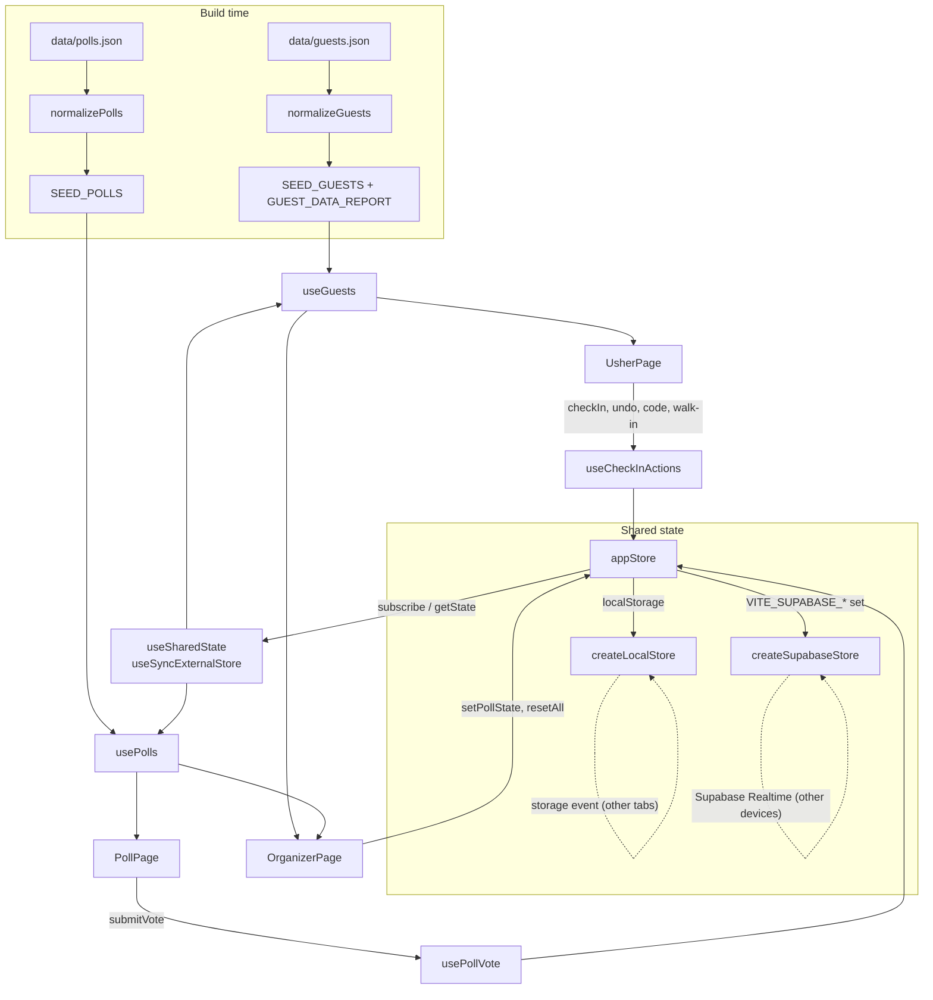

# LaunchPad: Codebase Walkthrough

A guided tour of the code, written so every part can be explained to a judge. Decision numbers (D1–D25) refer to `docs/DECISIONS.md`, which records the alternatives that were rejected.

---

## 1. The 60-second overview

**What it is:** LaunchPad is a mobile-first web app for Oxygene's product launch (about 200 guests).

**Live:** https://oxygene-assessment.vercel.app (staff PIN for the demo: `2026`)

**Three screens:**

| Route        | Who                  | What it does                                                                                       |
| ------------ | -------------------- | -------------------------------------------------------------------------------------------------- |
| `/usher`     | Door staff (PIN)     | Search guests or type a ticket code, check in with one tap, undo, add walk-ins                     |
| `/poll`      | Attendees (no PIN)   | See the active question, vote once per device, see a confirmation                                  |
| `/organizer` | Events manager (PIN) | Live check-in count, live poll results, choose/open/close polls, reset demo data, guest data notes |

**Stack:** React 19 + Vite, React Router, plain CSS (design tokens + CSS Modules), Vitest. Shared data lives behind one store interface: **localStorage** (syncs between tabs of one browser) or **Supabase** (syncs across devices in real time). Hosted on Vercel.

**The core idea to explain:** All business rules (cleaning data, searching, check-in rules, vote counting) are **pure functions in `src/lib`** with unit tests. React components only display state and call actions. Screens never know where data is stored. They talk to `appStore`, which is either the local or the Supabase implementation (D5, D14).

---

## 2. Data flow



**In words:**

1. **Startup.** The guest and poll JSON files are bundled into the app. `src/data/seed.js` runs them through normalization once at startup (D11).
2. **Reading state.** Live state (check-ins, walk-ins, poll state, votes) lives in `appStore`. Components read it with `useSharedState()`, which uses React's `useSyncExternalStore`. Whenever the store calls its listeners, every subscribed component re-renders with the new snapshot.
3. **Combining.** `useGuests()` merges the static guest list with live check-ins and walk-ins. `usePolls()` merges the static polls with live poll state and votes.
4. **Changing state.** User actions go through hooks (`useCheckInActions`, `usePollVote`) or straight from `OrganizerPage` to store methods. Each store method returns `{ ok: true }` or `{ ok: false, error }`, and the UI shows a message either way (D17).
5. **Syncing.** Other tabs hear about changes through the browser's `storage` event. Other devices hear about them through Supabase Realtime (D24).

---

## 3. Folder-by-folder map

### Top level

| Path                           | Purpose                                                                                         |
| ------------------------------ | ----------------------------------------------------------------------------------------------- |
| `data/guests.json`             | Stand-in guest export (152 rows, deliberately messy) (D2)                                       |
| `data/polls.json`              | Three seed poll questions                                                                       |
| `vite.config.js`               | Vite + Vitest config; maps only the two _public_ Supabase env vars into the browser build (D24) |
| `vercel.json`                  | Vercel build settings and the SPA rewrite so `/poll` works on refresh                           |
| `eslint.config.js`             | ESLint flat config (JS recommended, react-hooks, react-refresh, Prettier last) (D4)             |
| `scripts/generate-poll-qr.mjs` | Writes `docs/poll-qr.png`, the QR code for the live `/poll` URL (`npm run qr`)                  |
| `supabase/schema.sql`          | Tables, `cast_vote` and `reset_demo` functions, RLS policies, Realtime publication              |

### `src/` entry

| File       | Purpose                                                                        |
| ---------- | ------------------------------------------------------------------------------ |
| `main.jsx` | Mounts React into `#root` and imports global styles                            |
| `App.jsx`  | Staff-access provider + routes; `/usher` and `/organizer` wrapped in `PinGate` |

### `src/lib/`: pure logic (no React)

| File                 | Purpose                                                                                 |
| -------------------- | --------------------------------------------------------------------------------------- |
| `text.js`            | `cleanText`, `foldForSearch` (case/accent/space folding), `fixAllCapsOrLowerName`       |
| `normalizeGuests.js` | Turns raw guest rows into clean, flagged guests with stable ids; produces a data report |
| `normalizePolls.js`  | Validates polls (question + at least 2 distinct options)                                |
| `search.js`          | `searchGuests`: tokenized, accent-insensitive, ranked search                            |
| `checkIn.js`         | `getCheckInStatus`, `countCheckIns`, `createCheckInRecord`, `resolveCodeEntry`          |
| `walkIns.js`         | `validateWalkIn`, `createWalkIn`, `walkInToGuest`                                       |
| `votes.js`           | `getPollViewState`, `toPercentages`, `tallyVotes`                                       |
| `formatTime.js`      | `formatCheckInTime` ("17:45" or "time unknown")                                         |
| `staffAccess.js`     | PIN comparison and the session "unlocked" flag                                          |
| `constants.js`       | Route paths and app name                                                                |

### `src/lib/storage/`: where shared data lives

| File                 | Purpose                                                                                        |
| -------------------- | ---------------------------------------------------------------------------------------------- |
| `safeStorage.js`     | Crash-proof wrapper around localStorage/sessionStorage with the `launchpad:v1:` key prefix     |
| `sharedState.js`     | Shape of shared state, validators (`sanitize*`), `addVote`, voting-round ids                   |
| `localStore.js`      | Store backed by localStorage, with cross-tab sync; also `CONNECTION_STATUS` and `STORE_ERRORS` |
| `supabaseStore.js`   | Store backed by Supabase: snapshot, Realtime, optimistic writes with rollback                  |
| `supabaseMapping.js` | Pure conversion between database rows and app state                                            |
| `appStore.js`        | Picks Supabase or localStorage once at startup; the only store the UI imports                  |
| `deviceFlags.js`     | "This device voted option X in poll Y, round Z" (double-vote prevention)                       |
| `testBackends.js`    | Fake in-memory and always-failing storage backends for tests                                   |

### `src/hooks/`

| File                     | Purpose                                                          |
| ------------------------ | ---------------------------------------------------------------- |
| `useSharedState.js`      | Subscribes a component to `appStore` via `useSyncExternalStore`  |
| `useGuests.js`           | Guests + walk-ins with live status, check-in counts, data report |
| `usePolls.js`            | Polls, poll state, the active poll, vote counts                  |
| `useConnectionStatus.js` | Live / Local / Connecting / Offline                              |
| `useStaffAccess.js`      | Context + hook for the staff unlock state                        |
| `usePageTitle.js`        | Sets the browser tab title per screen                            |

### `src/data/`

| File      | Purpose                                                                                   |
| --------- | ----------------------------------------------------------------------------------------- |
| `seed.js` | Imports the JSON, normalizes it, exports `SEED_GUESTS`, `GUEST_DATA_REPORT`, `SEED_POLLS` |

### `src/components/`: shared UI

| File                      | Purpose                                                                 |
| ------------------------- | ----------------------------------------------------------------------- |
| `AppShell.jsx`            | Header, skip link, `<main>`, connection banner, bottom nav (staff only) |
| `BottomNav.jsx`           | Check-in / Poll / Dashboard tabs                                        |
| `PinGate.jsx`             | Shows the PIN form until the session is unlocked                        |
| `StaffAccessProvider.jsx` | Holds `isStaff`, `unlock(pin)`, `lock()`                                |
| `StatusMessage.jsx`       | Feedback message with optional Undo, in an always-present live region   |
| `ConnectionStatus.jsx`    | Offline/connecting banner and the staff "Live" badge                    |
| `Button.jsx`              | `Button` and `LinkButton` with variants                                 |
| `Badge.jsx`               | Small labelled pill (status, ticket, warnings)                          |
| `EmptyState.jsx`          | "Nothing here / no results / error" message with next steps             |
| `ProgressBar.jsx`         | Accessible `role="progressbar"`                                         |
| `PageHeader.jsx`          | Page `<h1>` + description, sets tab title                               |
| `Wordmark.jsx`            | Oxygene wordmark linking home                                           |
| `icons.jsx`               | Inline SVG icons, all `aria-hidden` and always paired with text         |

### `src/features/`

| Folder       | Files and purpose                                                                                                                                                                                                                                                |
| ------------ | ---------------------------------------------------------------------------------------------------------------------------------------------------------------------------------------------------------------------------------------------------------------- |
| `usher/`     | `UsherPage` (orchestrates modes), `SearchBox`, `GuestList`, `GuestCard` (check-in/undo button), `ModeSwitch` + `usherModes.js`, `CodeEntry` (QR stand-in), `WalkInForm`, `guestBadges.js` (badge wording), `useCheckInActions.js` (all usher actions + messages) |
| `poll/`      | `PollPage` (picks the view state), `PollQuestion` (radio cards + submit), `VoteConfirmation`, `usePollVote.js` (submit + device memory)                                                                                                                          |
| `organizer/` | `OrganizerPage`, `CheckInSummary`, `PollResults` (bars), `PollControls`, `ResetDemo`, `DataNotes`, `Panel`                                                                                                                                                       |
| `home/`      | `HomePage` (guests → poll, staff → check-in/dashboard), `NotFoundPage`                                                                                                                                                                                           |

### `src/styles/`

| File          | Purpose                                                                |
| ------------- | ---------------------------------------------------------------------- |
| `tokens.css`  | All brand colours, type scale, spacing, radius, touch-target size (D7) |
| `globals.css` | Reset, body defaults, focus ring, `.visually-hidden`, reduced motion   |

---

## 4. Feature tours

### 4.1 Usher: search

1. `UsherPage` keeps `query` in state and runs `searchGuests(guests, query)` inside `useMemo` on every keystroke.
2. **Matching.** `searchGuests` folds the query (lower case, no accents, single spaces) and splits it into words. A guest matches if **every** word appears in their pre-built `searchText` (name, organization, code with and without the dash). So "equity grace" finds Grace Wambui at Equity Bank.
3. **Ranking.** Exact code first, then names starting with the query, then names with a word starting with it, then anything else. Alphabetical within each group.
4. **Limit.** At most 50 cards render; a "keep typing" hint covers the rest.
5. **No delay.** About 150 guests filter in well under a millisecond, so there's no debounce and no index (D15).
6. **States.** No query → "Find a guest" (with an Add walk-in button). No match → "No guests match…" with tips and a walk-in button. Empty guest list → an error state.

### 4.2 Usher: check-in and undo

1. Each `GuestCard` shows a big **Check in** button, or **Undo check-in** if the guest is already in. The button is disabled while saving, so a double tap can't send two writes.
2. `useCheckInActions.checkIn(guest)` handles the tap:
   - If the guest is already checked in, it shows "already checked in (17:45)" and does nothing else (D17).
   - Otherwise it calls `changeStatus`, which remembers the **previous status**, calls `appStore.setCheckIn(id, createCheckInRecord())`, and shows "Checked in. Welcome, Name!" with **Undo**.
3. **Undo** writes the remembered previous status back. That is why undo is exact: an early arrival from the original list goes back to "checked in", not "not checked in".
4. **Storage model.** Check-ins are stored as overrides keyed by guest id; the guest list itself is never edited. `getCheckInStatus` returns the override if present, otherwise the list's own status (D13).
5. **After checking in from search,** the search text is re-focused and selected, so typing the next name replaces it.

### 4.3 Usher: typed code entry (QR stand-in)

1. `ModeSwitch` toggles "Find guest" / "Enter code". `CodeEntry` uses a numeric keypad.
2. On submit, `checkInByCode` calls `resolveCodeEntry(guests, input)`. It normalizes the input with the same `normalizeCheckInCode` used on the data, so `1049`, `oxy1049` and `OXY-1049` are equal. It returns one of five outcomes:

| Outcome              | What the usher sees                                                       |
| -------------------- | ------------------------------------------------------------------------- |
| `empty`              | "Type a check-in code first."                                             |
| `not-found`          | "No guest has the code OXY-9999…" (code stays selected to retype)         |
| `ambiguous`          | "2 guests share OXY-1252…": both cards listed, **nobody auto-checked in** |
| `already-checked-in` | "Name is already checked in (time)."                                      |
| `ready`              | Checked in immediately, with Undo; the box clears for the next guest      |

3. A real QR scanner would plug into the same `checkInByCode` (D18).

### 4.4 Usher: walk-ins

1. **Opening the form.** "Add a walk-in" opens `WalkInForm`, pre-filled with the search text. Name is required; organization is optional; ticket type defaults to General.
2. **Duplicate guard.** `validateWalkIn` checks the name. If the folded name matches existing guests, the form lists them and the button changes to "Add anyway".
3. **Saving.** `createWalkIn` builds a record with a unique `walk-in-…` id. `addWalkIn` stores it, then checks the guest in.
4. **Reading back.** When walk-ins are read, `walkInToGuest` runs them through the same `normalizeGuestRecord` as list data (stored data is untrusted) and flags them "Walk-in". `useGuests` adds them to the list and counts (D19).

### 4.5 Attendee poll

1. `PollPage` combines `usePolls()` (active poll and whether it's open) with `usePollVote()` (has this device voted?). It asks `getPollViewState` which of four states to show: **no active poll**, **open**, **already voted**, or **closed** (D22).
2. **While connecting** to Supabase it shows "Loading the live poll" instead of flashing "No poll right now".
3. **Voting is two steps:** pick a radio card, then press **Submit vote**, because votes can't be changed (D20). The radio inputs are real `<input type="radio">` inside a `<fieldset>` whose `<legend>` contains the question `<h1>`, so arrow keys and screen readers work.
4. `usePollVote.submitVote` **counts the vote first** (`appStore.castVote`), then **remembers it on the device** (`recordDeviceVote`). If the vote fails (for example, the organizer just closed voting), the device isn't locked out.
5. **Device memory is per voting round.** Every "Reset demo data" sets a new `votingRound` in the shared poll state, and device entries are keyed `round/pollId`. After a reset, old entries stop matching on **every** phone, even ones the organizer can't reach (D21).
6. **If storage is blocked,** the vote is remembered in memory for the life of the page.

### 4.6 Organizer dashboard

- **`CheckInSummary`:** "34 of 146 checked in", the percentage, a progress bar, people still to arrive, and how many are walk-ins. From `countCheckIns`.
- **`PollResults`:** `tallyVotes(poll, counts)` pairs each option with its count and percentage. The percentages come from `toPercentages`, which uses the largest-remainder method so they always total exactly 100. The bars are one brand colour; every bar has its number as text, and the leading answer is bold, so nothing is colour-only.
- **`PollControls`:** Radio list of polls plus "No poll". **Selecting a poll always closes voting**, and a separate Open/Close button makes going live deliberate. Each poll shows its vote total.
- **`ResetDemo`:** Inline "Reset everything? This can't be undone." On confirm it clears this device's vote flags and calls `appStore.resetAll()`, which clears check-ins, walk-ins and votes, resets poll state and starts a new voting round.
- **`DataNotes`:** Shows the normalization report: 152 rows became 146 guests, 3 duplicates merged, 3 rows skipped, 1 shared code, 2 shared names (D23).

### 4.7 Staff PIN

- **What is protected.** `/usher` and `/organizer` are wrapped in `PinGate`. `StaffAccessProvider` holds `isStaff`; `unlock(pin)` compares against `VITE_STAFF_PIN` (default `2026`) and stores the flag in sessionStorage, so it lasts until the tab closes. **Lock** clears it.
- **Navigation.** The bottom nav only renders for unlocked staff, so attendees scanning the QR code see just the poll.
- **Honest limitation.** This is a **deterrent, not security**: the PIN is in the JavaScript bundle (D8).

### 4.8 Live sync

- **Same browser.** `createLocalStore` listens for the `storage` event, which the browser fires in every _other_ tab when localStorage changes. It re-reads its slices and notifies listeners. Before every write it also re-reads the latest value (`updateSlice`), so two tabs don't overwrite each other.
- **Across devices.** `createSupabaseStore`:
  1. On first subscribe, it loads all four tables.
  2. It subscribes to Realtime `postgres_changes`. On any change it re-fetches that table.
  3. A 15-second safety-net poll runs while Realtime is down, and going back online triggers a full refresh.
- **Optimistic writes.** `saveOptimistically` updates the screen immediately, saves, and on failure restores the previous state and returns "Couldn't reach the server, so this wasn't saved…".
- **Rules in the database.** `cast_vote` only inserts a vote if that poll is active and open, in one SQL statement. `reset_demo` clears everything and sets the new round in one transaction.
- **Choosing a store.** `appStore.js` uses Supabase if a URL and public key were present at build time, otherwise localStorage.
- **Connection status.** Staff see a header badge: Live / This browser only / Connecting / Offline. Everyone sees a banner when connecting or offline (D24).

---

## 5. Important functions

| Function                                               | File                           | What it does                                                                                                                                 | Why it's built that way                                                                                              |
| ------------------------------------------------------ | ------------------------------ | -------------------------------------------------------------------------------------------------------------------------------------------- | -------------------------------------------------------------------------------------------------------------------- |
| `normalizeCheckInCode`                                 | `lib/normalizeGuests.js`       | Turns any code format (`oxy1049`, `OXY 1049`, `1049`, the number 1049) into `OXY-1049`; `null` if empty                                      | Used on both the data **and** what ushers type, so they always compare equal                                         |
| `normalizeGuestRecord`                                 | `lib/normalizeGuests.js`       | Cleans one row: field-name aliases, whitespace, caps, ticket-type aliases, defaults, flags, `searchText`                                     | The single boundary for untrusted data; reused for walk-ins                                                          |
| `normalizeGuests`                                      | `lib/normalizeGuests.js`       | Normalizes all rows; skips unusable rows; merges exact duplicates; assigns stable unique ids; flags shared codes and names; returns a report | Fix what's certain, flag what isn't (D12). Ids come from the data, never randomness, so every device agrees          |
| `searchGuests`                                         | `lib/search.js`                | Tokenized, accent-insensitive search with ranking and a result cap                                                                           | Instant at this size; words in any order; exact codes first (D15)                                                    |
| `getCheckInStatus`                                     | `lib/checkIn.js`               | The event override if present, otherwise the guest-list status                                                                               | Undo and reset are trivial; the list is never mutated (D13)                                                          |
| `resolveCodeEntry`                                     | `lib/checkIn.js`               | Maps typed input to empty / not-found / ambiguous / already-checked-in / ready                                                               | Pure and fully tested; never guesses between guests sharing a code (D18)                                             |
| `createWalkIn` / `walkInToGuest`                       | `lib/walkIns.js`               | Builds a stored walk-in record; converts a stored record back into a normal guest                                                            | Walk-ins go through the same normalization as list data (D19)                                                        |
| `getPollViewState`                                     | `lib/votes.js`                 | Decides no-poll / open / already-voted / closed                                                                                              | One source of truth for the attendee screen; "already voted" wins over "closed" (D22)                                |
| `toPercentages`                                        | `lib/votes.js`                 | Whole percentages that always sum to 100 (largest remainder)                                                                                 | Plain rounding can show 33 + 33 + 33 = 99                                                                            |
| `tallyVotes`                                           | `lib/votes.js`                 | Pairs options with counts and percentages; missing counts are 0, extras ignored                                                              | Tolerates malformed or outdated vote data                                                                            |
| `createSafeStorage`                                    | `lib/storage/safeStorage.js`   | `readJson`/`writeJson`/`remove` that never throw; versioned `launchpad:v1:` keys                                                             | Storage can be blocked, full or corrupted; failures return fallbacks and are reported, never silent                  |
| `createLocalStore` (`updateSlice`, storage event)      | `lib/storage/localStore.js`    | Read-modify-write per slice; validates everything read; listens for other tabs                                                               | Two tabs can't clobber each other; if saving fails, memory still updates and an error is returned                    |
| `createSupabaseStore` (`saveOptimistically`, Realtime) | `lib/storage/supabaseStore.js` | Same interface as the local store; snapshot + Realtime + safety-net polling; optimistic writes with rollback                                 | Cross-device sync with instant feedback and honest errors (D24)                                                      |
| `cast_vote` / `reset_demo`                             | `supabase/schema.sql`          | Vote only if the poll is active and open (one statement); reset everything and set a new round (one transaction)                             | Rules enforced in the database, not just the browser; no race with "close voting"                                    |
| `useSharedState`                                       | `hooks/useSharedState.js`      | `useSyncExternalStore(appStore.subscribe, appStore.getState)`                                                                                | React's built-in, tear-free way to read an external store; the store keeps the same snapshot object until it changes |

---

## 6. Testing

**What's covered:** 15 test files, **123 tests**, all in `src/lib`. Business logic is pure, so it's tested without a browser:

- **Text helpers:** `text.test.js`.
- **Normalization:** `normalizeGuests.test.js` (including assertions against the real sample file), `normalizePolls.test.js`.
- **Search:** `search.test.js`.
- **Check-in and walk-in rules:** `checkIn.test.js`, `walkIns.test.js`.
- **Vote counting and poll states:** `votes.test.js`.
- **Formatting and PIN:** `formatTime.test.js`, `staffAccess.test.js`.
- **Storage:** `safeStorage`, `sharedState`, `localStore` (including cross-tab events and blocked storage), `deviceFlags`, `supabaseMapping`, and `supabaseStore` (with a fake Supabase client: optimistic writes, rollback, closed poll, reset).

**How to run:**

```bash
npm test           # run once
npm run test:watch # re-run on change
npm run lint
npm run format:check
```

**Manual and automated browser checks** (Chrome via Playwright scripts, not committed):

- Every usher, poll and organizer flow.
- Cross-tab sync.
- Layouts at 360, 390, 768 and 1280px wide.
- An axe-core accessibility audit across 13 screens and states (D25).

---

## 7. Likely judge questions

**1. Why localStorage _and_ Supabase?**
The brief asked for localStorage, but localStorage can't sync between phones, and the demo runs on real phones. Both sit behind one store interface. Supabase is used when configured; otherwise the app still works as a single-browser demo. Swapping between them changes one file, `appStore.js` (D5, D24).

**2. What if two ushers check in the same guest at once?**
The second tap sees the guest already checked in once sync arrives, and gets "already checked in (time)" instead of overwriting the first time. If both writes land within the same instant, the database simply holds one `check_ins` row for that guest (last write wins, same result). No duplicate is possible because the row is keyed by guest id.

**3. How do you prevent double voting, and what are the limits?**
After a vote, the device stores which option it chose for that poll and voting round, and the poll screen then shows the thank-you instead of the question. The limit: a private window or cleared browser data allows another vote. Real prevention needs identity (login, or a one-time code per guest). IP addresses don't work because everyone shares venue Wi-Fi (D21).

**4. How does "Reset demo data" let every phone vote again?**
It starts a new `votingRound` in the shared poll state. Phones store votes per round, so old entries stop matching everywhere, including phones the organizer can't touch (D21).

**5. Why not TypeScript?**
Less syntax to explain, and faster to build. The real risk is bad data at _runtime_, which TypeScript can't catch; the normalization layer and the `sanitize*` validators do. Types are documented with JSDoc (D3).

**6. Why no UI library?**
It would be heavy and harder to match the brand. Plain CSS with design tokens and CSS Modules is small, explainable, and scoped per component (D7).

**7. How do you handle bad data?**
Every row goes through `normalizeGuestRecord`:

- **Fixed:** whitespace, capitals, code formats, ticket spellings, field-name variants.
- **Safe defaults:** "Unnamed guest", "No organization", "Unspecified" (never assuming General).
- **Skipped and reported:** rows that are unusable.
- **Merged:** exact duplicates only.
- **Flagged for the usher:** shared codes and shared names.

Data read back from storage or the network is validated again. Nothing throws on bad input; the tests feed it `null`, strings, `{}` and corrupted JSON (D12).

**8. What happens offline?**
The guest list is bundled, so search keeps working once the page has loaded. With Supabase, a banner says "Connection lost"; writes that fail roll back with a clear error, and the store reconnects and catches up automatically. With localStorage there's no network to lose (D11, D24).

**9. How is the PIN secured?**
It isn't, really. It's a deterrent that keeps curious attendees out of staff screens. The PIN is compiled into the JavaScript. Real protection would be Supabase Auth with staff accounts (D8).

**10. Why do the percentages always add up to 100?**
`toPercentages` rounds every option down, then hands the leftover points to the options that lost the most in rounding (largest-remainder method). Plain rounding can show 99% or 101% in total.

**11. How would you add real QR scanning?**
Encode each guest's check-in code in their ticket QR. Add a camera scanner component (for example, the browser's `BarcodeDetector`, or a small library) that passes the decoded text to the existing `checkInByCode`. Every outcome and message already exists (D18).

**12. How would this scale to 5,000 guests?**

- Search is a linear scan; at 5,000 it is still only a few milliseconds, but I'd add a short debounce and render fewer cards.
- Bundling the list would get large, so I'd load it from Supabase instead.
- I'd count votes in the database rather than fetching every vote row.
- I'd send Realtime row changes as patches instead of re-fetching whole tables.

**13. Is the Supabase anon key a security problem?**
The anon key is designed to be public; Row Level Security decides what it can do. Here the policies are deliberately open for the demo: anyone with the key can read and write check-ins, walk-ins and poll state. Votes can only be added through `cast_vote`. That's acceptable for a one-evening demo; production would require staff login for check-ins and poll control (D24).

**14. Why bundle the guest list instead of fetching it?**
It's instant (no loading spinner at the door), works if Wi-Fi drops after load, and is small (about 25 KB). The trade-off is that changing the list needs a redeploy, which takes about a minute on Vercel (D11).

**15. How did you verify accessibility?**

- An axe-core audit (WCAG 2.0/2.1 A and AA, plus best practices) on 13 screens and states. It found one issue, a missing `<h1>` on the open poll, which I fixed.
- Keyboard-only voting, and every colour pair measured against AA.
- Status is never colour alone: always text and an icon.
- Not done: testing with a real mobile screen reader (D25).

**16. Why is check-in a single tap with Undo, rather than a confirmation dialog?**
Speed at a busy door. Undo is just as safe and doesn't slow down the 99% of correct taps. Feedback appears under the input, where the usher is looking and where the phone keyboard won't hide it (D17).

**17. Why are some guests not merged even though they look like duplicates?**
Only records identical after cleaning are merged. The two Grace Wambuis work at different companies and have different codes. Auto-merging similar names could check in the wrong person, so they're flagged and the usher decides (D12).

**18. What would you do next?**

- Staff login with Supabase Auth and staff-only write policies.
- A real QR scanner.
- Loading the guest list from the database, with an import screen.
- Showing results to attendees after a poll closes.
- An offline queue for check-ins made while disconnected.
- End-to-end tests in CI.
- Testing with real ushers.
